# zmk-config-roBa (enuai)

roBa クローン(Seeed XIAO BLE × 2、右手トラックボール PMW3610、左手ロータリーエンコーダー)用の
ZMK ファームウェア設定。Windows + **US 配列**設定で使う前提。

キーマップの詳細(全レイヤーの表・コンボ・トラックボール設定)は **[KEYMAP_DETAILS.md](KEYMAP_DETAILS.md)** を参照。

## 構成

| パス | 内容 |
| :--- | :--- |
| `config/roBa.keymap` | キーマップ本体(レイヤー・コンボ・マクロ・ホールドタップ) |
| `config/west.yml` | 依存モジュール: ZMK `v0.3-branch`、PMW3610 ドライバ、ポインタ加速 |
| `config/roBa.json` | ZMK Studio / keymap-drawer 用の物理レイアウト |
| `boards/shields/roBa/roBa_R.conf` | 右手(Central)の設定: トラックボール CPI・加速・BLE・省電力 |
| `boards/shields/roBa/roBa_R.overlay` | 右手のピン定義・トラックボール・加速カーブ(`&vector_accel`) |
| `boards/shields/roBa/roBa_L.conf` | 左手(Peripheral)の設定: エンコーダー・省電力 |
| `build.yaml` | GitHub Actions のビルド対象(右手は ZMK Studio の USB スニペット付き) |
| `keymap-drawer/` | keymap-drawer が生成したキーマップ図(push 時に自動更新) |

## ビルドと書き込み

1. `main` に push すると GitHub Actions がビルドし、Artifacts に `roBa_R-seeeduino_xiao_ble-zmk.uf2`
   `roBa_L-seeeduino_xiao_ble-zmk.uf2` `settings_reset-seeeduino_xiao_ble-zmk.uf2` ができる。
2. 書き込む側の XIAO をブートローダーにする:
   - SETTING レイヤー(左エンコーダー押し込み長押し)+ `B`(左手) / `;`(右手)の `&bootloader`、
     または基板のリセットボタンを素早く 2 回押す。
   - `&bootloader` は**押した側の半身だけ**がブートローダーになる。
3. 現れた USB ドライブに該当する `.uf2` をコピーする。

### ZMK Studio を使うとき

- Studio は **Central(右手)** にしか接続できない。USB で使うときは右手を PC に挿す。
- Studio 上でキーマップを変更すると、その内容はフラッシュに保存され **`.keymap` を書き込み直しても
  Studio の変更が優先され続ける**。`.keymap` の内容に戻したいときは Studio の
  "Restore Stock Settings" を実行するか、`settings_reset` の uf2 を一度書き込む(BT ペアリングも消える)。

## 設計メモ

- IME の ON/OFF は `LANG1`(変換位置)/ `LANG2`(無変換位置)で行う(US 配列の Windows 向け)。
  `INT_HENKAN` / `INT_MUHENKAN` は JIS 配列設定のときだけ効くため使っていない。
- トラックボールは CPI 600 + ファームウェア側のポインタ加速(低速時は等倍、速く振ると最大 2.2 倍)。
  Windows の「ポインターの精度を高める」は OFF 推奨(二重に加速が掛かる)。
- コンボには `require-prior-idle-ms = 150` を付けて、高速タイピング中のロール打鍵で誤爆しないようにしている。
